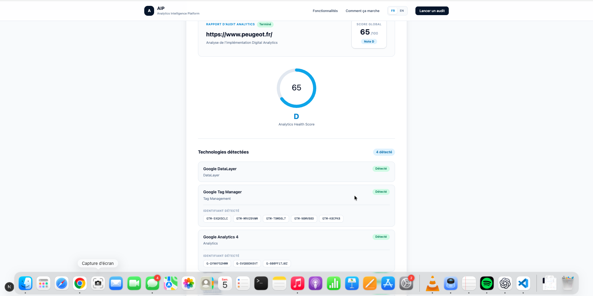
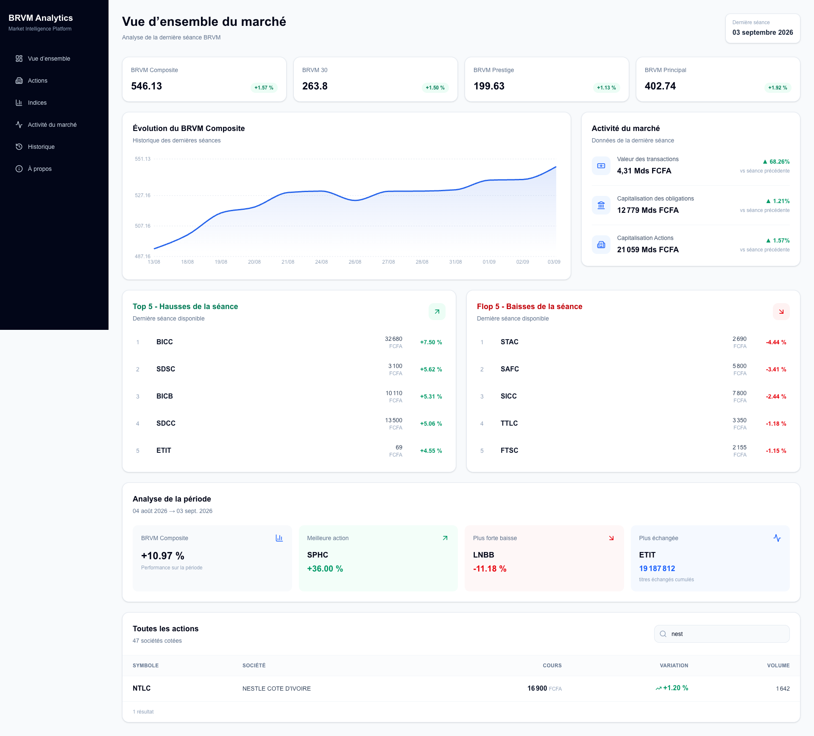

# 👋 Hi, I'm Brice Goye

### Senior Digital & Data Analyst

**Digital Analytics • Data • Python • Automation • AI**

I specialize in Digital Analytics and data-driven solutions, with experience working on large-scale digital environments for organizations including **Stellantis, CANAL+ and L'Oréal**.

My work sits at the intersection of **analytics implementation, data analysis, automation and AI-powered solutions**.

---

## 🚀 Featured Projects

### 🔎 AIP — Analytics Intelligence Platform

  

A Digital Analytics auditing platform designed to analyze websites and identify their analytics implementation.

AIP combines static analysis with browser-based runtime inspection to detect analytics technologies and evaluate implementation quality.

**Key capabilities**

- Analytics technology detection
- Google Tag Manager & GA4 identification
- DataLayer inspection
- Browser-based analysis with Playwright / Chromium
- Static + dynamic evidence analysis
- Analytics health scoring
- AI-generated audit recommendations

**Tech Stack**

`Next.js` `TypeScript` `Playwright` `OpenAI` `Digital Analytics`

👉 [View AIP on GitHub](https://github.com/Bricegoye/AIP)

---
### TagPlan Studio — Faciliter la création de plans de marquage
Projet visant à automatiser la préparation de plans de marquage à partir de standards existants, en les adaptant aux marques, marchés et parcours digitaux. L’objectif : réduire les tâches répétitives et rendre les livrables plus cohérents.

**Expertise mobilisée :** Digital Analytics, structuration des règles métier et automatisation.

### 📈 BRVM Analytics

  

An end-to-end market data and analytics platform for the **Bourse Régionale des Valeurs Mobilières (BRVM)**.

The platform automatically collects public market data, validates trading sessions, stores historical observations and exposes the information through an analytics dashboard.

**Key capabilities**

- Automated daily market-data collection
- Data-quality controls
- Historical market database
- Market indices & listed-company monitoring
- Automated pipelines with GitHub Actions
- Interactive analytics dashboard

**Tech Stack**

`Python` `PostgreSQL` `Supabase` `SQL` `Next.js` `TypeScript`

👉 [View BRVM Analytics](https://github.com/Bricegoye/BRVM)

🌐 [Live Dashboard](https://dashboard-brice-goye.vercel.app/)

---
### FIP — Exploiter les données pour faciliter la recherche de vols
Projet autour du suivi des prix des vols Paris–Abidjan et de la mise en relation des offres avec les préférences des voyageurs. L’objectif : transformer des données tarifaires en informations utiles pour orienter une recherche.

**Expertise mobilisée :** collecte de données, analyse et automatisation.

### Mon Carnet Pro — Simplifier le suivi de l’activité commerciale
Projet exploratoire destiné aux artisans et commerçants pour mieux suivre leurs commandes, paiements et livraisons. Il part d’un besoin concret de terrain pour concevoir un outil simple, adapté au quotidien des petites activités.

**Compétences développées :** analyse des besoins, conception produit et développement assisté par IA avec Codex.

## 🧰 Technical Skills

### Digital Analytics
`GA4` `Google Tag Manager` `Piano Analytics` `DataLayer` `A/B Testing`

### Data
`SQL` `Python` `Pandas` `BigQuery` `Snowflake` `Dataiku` `PostgreSQL`

### Engineering & Automation
`Git` `GitHub` `APIs` `Playwright` `n8n` `Workflow Automation` `Supabase` `Next.js` `TypeScript`

### AI
`OpenAI API` `AI-assisted Analytics` `AI Workflow Automation`

---

## 💼 Professional Background

I have worked across consulting and enterprise environments on Digital Analytics and Data projects, including missions for:

**Stellantis • CANAL+ • L'Oréal**

My experience covers analytics implementation, tracking architecture, data analysis, campaign data, data quality and digital measurement.

---

## 🎯 What I'm Building

I'm currently strengthening my expertise beyond traditional Digital Analytics by building end-to-end products combining:

**Digital Analytics → Data → Automation → AI**

My objective is to design analytics and data solutions that go beyond reporting and turn data into **automated, actionable decision-support systems**.

---

## 📫 Connect with me

[LinkedIn](https://www.linkedin.com/in/brice-goye-aa959bb1) • [GitHub](https://github.com/Bricegoye)
